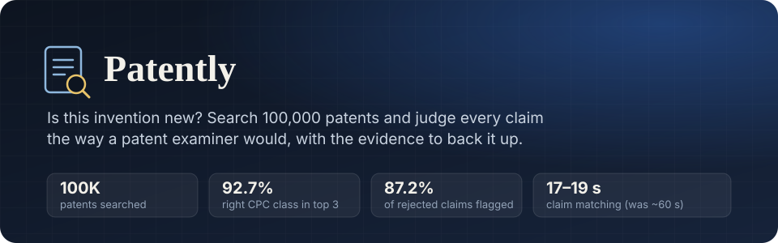
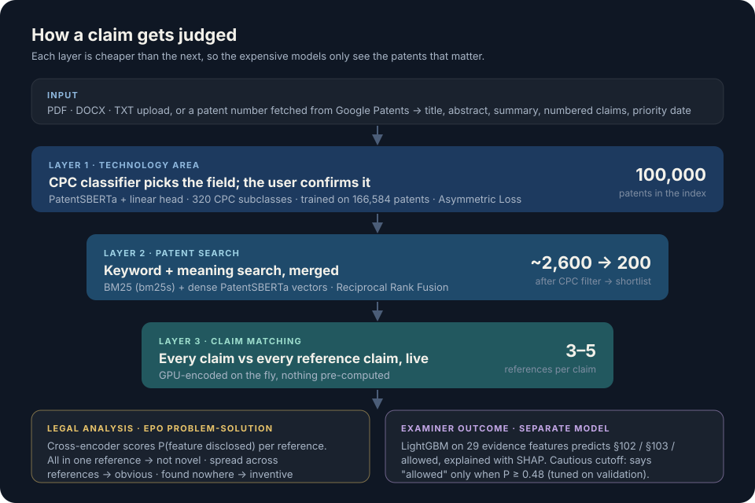
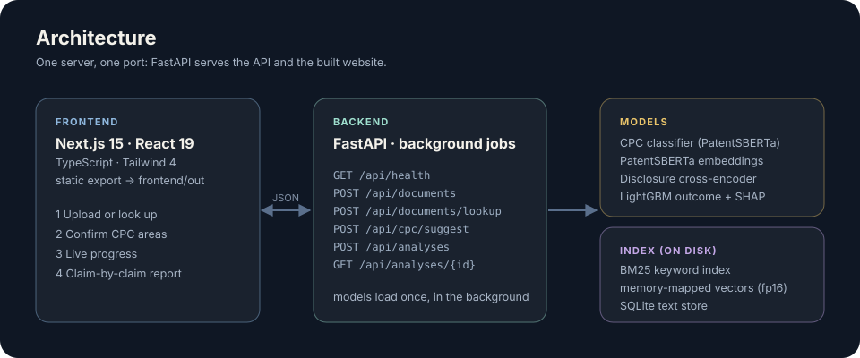
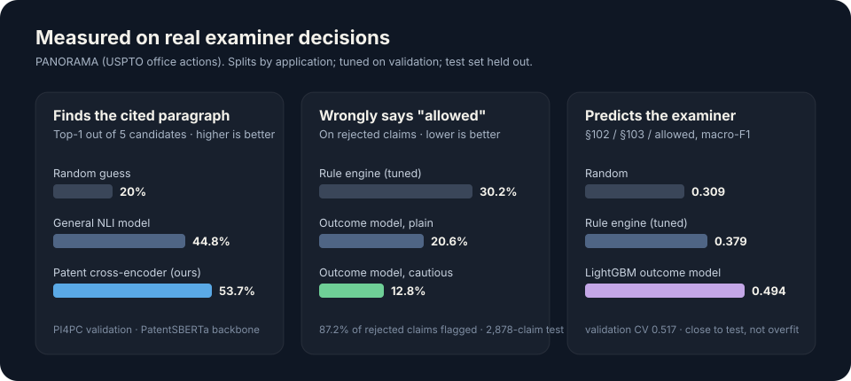

<div align="center">



<br/>

[](https://python.org)
[](https://pytorch.org)
[](https://huggingface.co/docs/transformers)
[](https://fastapi.tiangolo.com)
[](https://nextjs.org)
[](https://lightgbm.readthedocs.io)

**[How it works](#how-it-works)** · **[Results](#results)** · **[Quick start](#quick-start)** · **[Project layout](#project-layout)** · **[Contributing](#contributing)** · **[Full write-up](docs/PROJECT.md)**

</div>

---

## What it does

You give Patently a patent application (PDF, DOCX, TXT, or a patent number). It:

1. **Suggests the technology area** (CPC class), and you confirm it.
2. **Searches 100,000 older patents** for prior art, using keywords and meaning together.
3. **Compares every claim**, feature by feature, against the closest references.
4. **Judges each claim** the way the European Patent Office does: *not novel*, *obvious*, or *inventive*. Each verdict comes with the evidence passage and the reason.
5. **Predicts the examiner's decision** (§102 rejection, §103 rejection, or allowed) with a separate model, and says which factors drove it.

Everything runs live. Nothing is pre-computed for the demo patents.

> Automated research aid, not legal advice.

---

## How it works



<details>
<summary><b>Layer 1: CPC classifier</b> (narrows the search to the right technology)</summary>

- **Model:** PatentSBERTa encoder + mean pooling + a linear layer over **320 CPC subclasses**, so one patent can have several labels.
- **Data:** **166,584** HUPD patents, with splits by year (train 2011–2015, validation 2016, test 2017).
  v2 warm-started from v1 and added 102k new CPC-labelled patents.
- **Training:** Asymmetric Loss for the long tail of rare classes, early stopping, 2× T4 on Kaggle.
- **Result:** a correct class is in the **top 3 for 92.7%** of test patents (**top 5: 95.2%**).
- The user ticks the classes to keep, so a wrong guess never silently hides prior art.

</details>

<details>
<summary><b>Layer 2: hybrid patent search</b> (100,000 → 200 candidates)</summary>

- **Keyword:** BM25 (`bm25s`) over title, abstract and claims.
- **Meaning:** PatentSBERTa vectors for abstract, summary and claims (fp16, L2-normalised, memory-mapped).
- The two rankings are merged with **Reciprocal Rank Fusion**, then filtered by the confirmed CPC classes and the priority date.
- **Memory:** patent text sits in an on-disk SQLite store, and only IDs, titles, CPC codes and dates stay in RAM. This keeps memory low enough to run on a laptop.

</details>

<details>
<summary><b>Layer 3: claim matching</b> (live, on the GPU)</summary>

- Claims are split with a parser that cleans office-action noise (100% of 7,392 PANORAMA validation claims parse).
- Every query claim is encoded against every claim of the shortlisted patents **at request time**.
- Limiting this to the top 200 patents cut it from **~60 s to 17–19 s** on an RTX 2050.

</details>

<details>
<summary><b>Legal analysis: EPO problem-solution approach</b></summary>

- Each claim is broken into **features** (component, function, parameters) with spaCy.
- A **patent-trained cross-encoder** scores *P(feature is disclosed)* against each reference paragraph, blended with semantic, lexical and syntactic signals.
- **Rules:**
  - every feature in one reference → **not novel**;
  - the missing (distinguishing) features are found in other references → **obvious**;
  - a distinguishing feature found nowhere → **inventive**.
- Distinguishing features are labelled *new component*, *same component, new function* or *different parameter*.
- Technical or economic **advancements** linked to them strengthen the inventive finding.
- Thresholds were tuned on validation data (`analysis/disclosure_weights.json`).

</details>

<details>
<summary><b>Examiner-outcome model</b> (separate from the legal reasoning)</summary>

- **LightGBM**, 3 classes, using **29 features** drawn from the evidence: coverage, disclosure scores, claim depth, and others.
- **Splits:** by application, grouped 5-fold CV on validation, and an untouched test set.
- **SHAP** explains each prediction. It also exposed a feature that leaked the answer (the number of examiner-cited references), which was removed.
- **Cautious cutoff:** "allowed" is predicted only when P(allowed) ≥ 0.48, chosen on validation. A wrong "allowed" costs more than a wrong rejection.

</details>

### Architecture



---

## Results



All numbers are on held-out data from **PANORAMA** (real USPTO office actions). Splits are by application, every setting was tuned on validation only, and the test set was kept untouched.

| What | Result | Baseline |
|---|---|---|
| CPC classifier, correct class in top 3 / top 5 | **92.7% / 95.2%** | — |
| Disclosure model: picks the examiner-cited paragraph out of 5 | **53.7%** | general NLI 44.8%, random 20% |
| Prior-art cases caught (§102 + §103 recall) | **87.2%** | rule engine 69.8% |
| Wrongly predicts "allowed" (false-allow rate) | **12.8%** | rule engine 30.2% |
| Examiner outcome, macro-F1 (3 classes) | **0.494** | tuned rules 0.379, random 0.309 |

<details>
<summary>Confusion matrix (test set, 2,878 claims, cautious cutoff)</summary>

| examiner ↓ / model → | §102 | §103 | Allowed |
|---|---|---|---|
| **§102** (828) | 508 | 243 | 77 |
| **§103** (1,453) | 452 | 786 | 215 |
| **Allowed** (597) | 227 | 178 | 192 |

</details>

**Limits:**
- Only 1.6% of the references examiners cite are in the 100k index, so the legal verdicts are judged against the prior art the system finds, not the examiner's own.
- Examiner decisions are noisy: experts agree with each other about 75% of the time.

The full story, including what broke and how it was fixed, is in **[docs/PROJECT.md](docs/PROJECT.md)**.

---

## Quick start

### 1. Clone and install

```bash
git clone https://github.com/KalpeshEragi/Patently.git
cd Patently

python -m venv venv
source venv/bin/activate          # Windows: venv\Scripts\activate
pip install -r requirements.txt
python -m spacy download en_core_web_sm
```

A GPU is optional but recommended. Install the CUDA build of PyTorch from [pytorch.org](https://pytorch.org/get-started/locally/) before the requirements.

### 2. Build the data and models

The models and the patent index are too big for git. Build them once (or download them from the project's Hugging Face Hub repo once it's published):

```bash
# 100k-patent prior-art index (streams HUPD, then builds BM25 + vectors + text store)
python -m retrieval.build_corpus --per-year 20000
python -m retrieval.build_index --index retrieval/index

# CPC classifier (GPU; the v2 run was trained on Kaggle 2x T4)
python -m cpc_classifier.data_prep
python -m cpc_classifier.train --epochs 3

# disclosure cross-encoder (trained on PANORAMA PI4PC)
python -m disclosure_model.train_ce --backbone AI-Growth-Lab/PatentSBERTa --out disclosure_model/ce_patentsberta

# examiner-outcome model + cautious cutoff (validation only)
python -m eval.run_noc4pc --split validation
python -m eval.train_outcome
python -m eval.tune_allow
```

Every script has a `--quick` or `--smoke` option for a small test run.

### 3. Run it

```bash
# build the website once
cd frontend && npm install && npm run build && cd ..

# start the API, which also serves the website
uvicorn api.main:app --port 8000
```

Open **http://localhost:8000**, or **http://localhost:8000/docs** for the interactive API docs. Models take about a minute to load, and the status dot turns green when they're ready.

For frontend development with hot reload, run `npm run dev` in `frontend/` (port 3000). It talks to the API on port 8000.

### 4. Test

```bash
pytest tests/test_api.py -s       # real models: lookup -> CPC -> full analysis
```

---

## Project layout

```text
analysis/           extraction, claim features, disclosure scoring, EPO engine, outcome model
api/                FastAPI app: documents, CPC suggestions, analysis jobs
cpc_classifier/     Layer 1: data prep, training, prediction
retrieval/          Layers 2-3: corpus, BM25 + vector index, text store, claim matcher
disclosure_model/   patent cross-encoder training
eval/               PANORAMA evaluation, tuning, outcome training, error analysis
frontend/           Next.js 15 app (static export served by FastAPI)
tests/              API tests against the real models
docs/               PROJECT.md (full write-up) and README diagrams
```

The root-level `app.py`, `main.py`, `comparator.py` and similar files are the **first prototype** (Streamlit + MiniLM). They're kept for history and will be removed in a later cleanup.

---

## Tech stack

| Area | Tools |
|---|---|
| Models | PyTorch, Hugging Face Transformers, Sentence-Transformers, PatentSBERTa, LightGBM, SHAP |
| Search | bm25s, NumPy memory-mapped vectors, Reciprocal Rank Fusion, SQLite |
| NLP | spaCy, custom claim parser, PyMuPDF / pdfplumber / python-docx |
| Backend | FastAPI, Uvicorn, background job worker |
| Frontend | Next.js 15, React 19, TypeScript, Tailwind CSS 4 |
| Training | Kaggle 2× T4, fp16, grouped cross-validation |

---

## Contributing

Contributions are welcome: bug reports, ideas, or code.

1. **Open an issue first** for anything bigger than a small fix, so we can agree on the approach.
2. **Fork** the repo and create a branch: `git checkout -b feat/short-name`.
3. **Keep the evaluation honest:**
   - tune only on validation data;
   - never look at the test set while developing;
   - report new numbers next to their baseline.
4. **Run the tests** (`pytest tests/test_api.py -s`) and `npm run lint` in `frontend/`.
5. **Write clear commits** in the [Conventional Commits](https://www.conventionalcommits.org/) style (`feat:`, `fix:`, `docs:` ...).
6. **Open a pull request** describing what changed, why, and how you tested it. Include screenshots for UI changes.

**Please don't commit:**
- model weights, the index, or datasets (they're in `.gitignore`);
- `.env` files or API keys.

---

## Data and licences

| Dataset | Use | Licence |
|---|---|---|
| [HUPD](https://huggingface.co/datasets/HUPD/hupd) (Harvard USPTO Patent Dataset) | CPC training, 100k prior-art corpus | CC BY-SA 4.0 |
| [PANORAMA](https://huggingface.co/datasets/LG-AI-Research/PANORAMA) (LG AI Research) | evaluation, disclosure-model training | CC BY-NC 4.0 (non-commercial) |

Because PANORAMA is non-commercial, the trained disclosure model is for non-commercial use only. The pretrained encoder is [PatentSBERTa](https://huggingface.co/AI-Growth-Lab/PatentSBERTa) (AI Growth Lab).

<div align="center"><sub>Built by <a href="https://github.com/KalpeshEragi">Kalpesh Eragi</a></sub></div>
